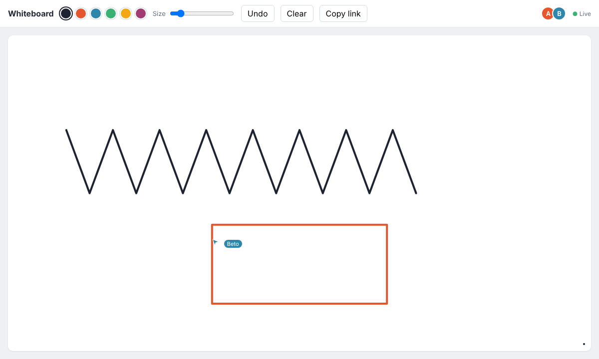

# Realtime Whiteboard

A collaborative whiteboard where several people draw on the same board at the same time and see each other's strokes and cursors live. **React + TypeScript** on the client, **Node.js + Socket.IO** on the server, with a typed event protocol shared by both.



*Screenshot from an automated test: "Ana" drew the zigzag, "Beto" drew the rectangle, and Beto's cursor appears on Ana's screen.*

## Features

- Rooms by link (`?room=abc123`): share the URL and others join the same board
- Live strokes: points are streamed while you draw, not only when you finish
- Live cursors with names, and avatars of who's on the board
- Undo your own last stroke (`Ctrl+Z`) without touching other people's drawing
- Clear the board for everyone, with a notice saying who did it
- Late joiners receive the full board
- Coordinates stored in the 0..1 range, so the board looks the same on any screen size

## Tech stack

| Part | Choice |
| --- | --- |
| Client | React 19, TypeScript, Vite, HTML canvas, Socket.IO client |
| Server | Node.js 22, Express 5, Socket.IO, Zod |
| Contract | `shared/protocol.ts`: typed events used by both sides |
| Tests | Vitest: unit tests for the room logic and the client reducer, integration tests with real sockets |
| Delivery | Single multi-stage Docker image, GitHub Actions |

## Run it

```bash
docker build -t realtime-whiteboard .
docker run -p 3000:3000 realtime-whiteboard
# open http://localhost:3000 in two browser windows
```

Development, with hot reload:

```bash
cd server && npm install && npm run dev     # Socket.IO on :3001
cd client && npm install && npm run dev     # Vite on :5173, proxies /socket.io to :3001
```

## How it works

```
Browser A ──stroke:start / stroke:points──▶ Server ──broadcast to room──▶ Browser B, C…
          ◀──────board:state on join──────        (keeps strokes in memory)
```

| Event (client → server) | What happens |
| --- | --- |
| `room:join` | Validated, user gets a color, receives `board:state`; others get `user:joined` |
| `stroke:start` | New stroke stored and sent to the others |
| `stroke:points` | Points appended **only if the stroke belongs to the sender**, then relayed |
| `stroke:undo` | Removes the sender's latest stroke; everyone gets `stroke:remove` |
| `board:clear` | Empties the board; everyone gets `board:cleared` |
| `cursor:move` | Relayed as a *volatile* message: if a client is slow, old cursor positions are dropped |

## Design decisions

- **Shared, typed protocol.** Socket.IO's generic types use `ServerToClientEvents` / `ClientToServerEvents` from `shared/`, so a renamed event or a changed payload is a compile error on both sides.
- **Never trust the socket.** Every payload is validated with Zod (room id format, coordinate range, color format, batch size), message size is capped and rooms have limits on users, strokes and points.
- **Batching.** The client buffers points and sends them every 40 ms, and cursor updates are throttled to about 20 per second, which cuts traffic by an order of magnitude compared with one message per mouse event.
- **Optimistic UI.** Your own strokes are drawn immediately; the server relays them to others, not back to you.
- **Pure state logic.** `RoomStore` (server) and `boardReducer` (client) have no networking in them, so most behavior is covered by fast unit tests.
- **Memory hygiene.** Rooms are deleted 30 minutes after the last person leaves.

## Tests

```bash
cd server && npm test    # 13 tests: room rules + real Socket.IO clients against a test server
cd client && npm test    # 7 tests: reducer and coordinate mapping
```

## Possible next steps

- Persist boards in Redis and use the Socket.IO Redis adapter to run several server instances
- Shapes, text and an eraser
- Export the board as PNG

## License

MIT
